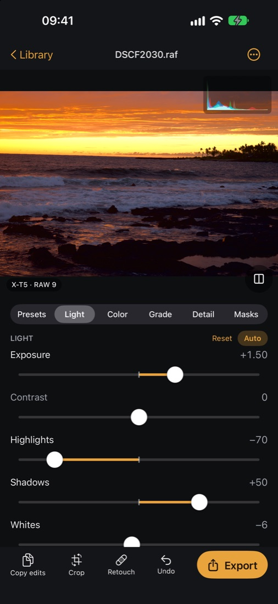
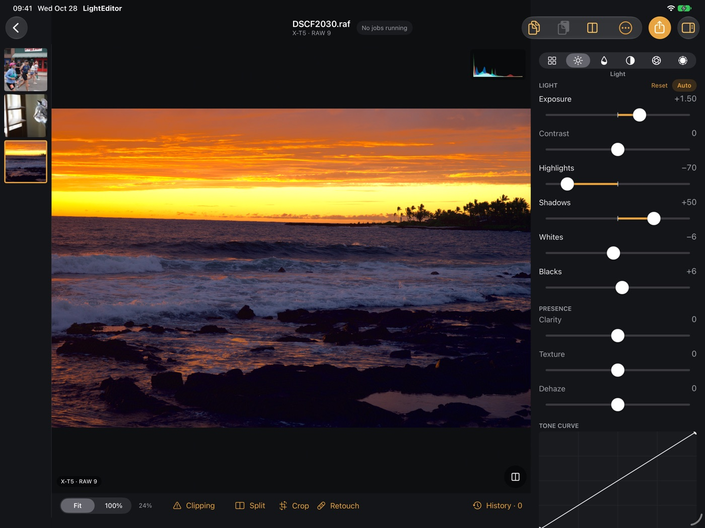

# LightEditor

A free, open-source RAW photo editor for iPhone, iPad and Mac, built for quick, color-focused edits while traveling. Apple Photos is the library: your originals stay untouched, edits are saved non-destructively, and iCloud Photos syncs them. Everything runs on your device. There are no accounts, servers, ads or analytics, and it will always be free of subscriptions.

Coming to the App Store for iPhone and iPad, with the Mac version to follow.

<p align="center">
  
  
</p>

## Features

- **RAW 9 decoding** (`CIRAWFilter`) for supported cameras, such as Sony ARW, Fujifilm RAF and iPhone ProRAW. JPEG and HEIC work too.
- **Light:** exposure, contrast, highlights, shadows, whites, blacks, Auto, plus Clarity, Texture and Dehaze.
- **Color:** white balance, vibrance, saturation, and an 8-band HSL mixer by color or by property.
- **Grade:** shadow, midtone, highlight and global color wheels, film LUTs, vignette and grain.
- **Detail:** RAW-stage noise reduction and sharpening, from Apple's RAW engine.
- **Tone curve, crop and straighten**, with perspective, auto-straighten, 65:24 and custom ratios.
- **Masks:** linear and radial gradients, brush, luminance and color ranges, and AI subject, sky, people and tap-to-select masks (Apple Vision).
- **Retouch:** heal and clone, plus AI object removal with LaMa, or LaMa followed by Stable Diffusion inpainting for a more photographic fill.
- **Presets:** Fujifilm-style film looks, your own presets with an Amount slider, `.cube` LUTs, and Lightroom XMP preset import.
- **Batch editing:** copy and paste edits with paste groups, bulk edits in "Set values" or "Adjust by" mode, and Match previous.
- **Remote editing:** your iPhone shares its library to your iPad over peer-to-peer Wi-Fi, encrypted end to end, with no router or internet needed.
- **iPhone Duo:** unfolded, the inner screen gets the iPad layouts: photo and tools side by side when it's sideways, a big photo over a roomy panel when it's upright. Folded, it's the phone editor.
- **Built for touch:** pull away from a slider for fine control, double-tap to reset, press and hold to compare. Before/after has a draggable split.
- **A job tray** for every slow task, with progress and cancel.

Requires iOS, iPadOS or macOS 27, because RAW 9 decoding is new in OS 27.

## Privacy

LightEditor collects no data. It has no servers, analytics, crash reporting or ads, and it never sends your photos anywhere. All decoding, editing and AI (masks and object removal) run on your device. The only network traffic is between your own devices when you turn on remote editing, and that link is direct and encrypted. See the [privacy policy](docs/app-store/privacy-policy.md).

## Building

You need a Mac with Xcode 27 and [XcodeGen](https://github.com/yonaskolb/XcodeGen).

```sh
brew install xcodegen
git clone https://github.com/chriskonstad/LightEditor.git && cd LightEditor
scripts/build.sh      # generates the Xcode project, then builds for macOS and iOS
scripts/test.sh       # EditorCore unit tests on the Mac (add --ios for a simulator)
```

The `.xcodeproj` is generated from `project.yml`; don't edit it by hand. Run `xcodegen generate` and open `LightEditor.xcodeproj` to work in Xcode.

**The Mac and the iOS Simulator need no signing setup.** To run on your own iPhone or iPad, copy the example signing config and fill in your team and a bundle ID you own:

```sh
cp Config/Signing.local.xcconfig.example Config/Signing.local.xcconfig
```

`Config/Signing.local.xcconfig` is git-ignored. `scripts/install-device.sh` then builds and installs on a connected device.

### AI removal models (optional)

The object-removal models are large, so they aren't in git. Without them the app builds and runs, and hides AI removal. To build them (needs [uv](https://docs.astral.sh/uv/)):

```sh
scripts/fetch-models.sh                    # LaMa (~100 MB) and Stable Diffusion inpainting (~780 MB), 20–40 min
SKIP_DIFFUSION=1 scripts/fetch-models.sh   # LaMa only
```

The script downloads the published weights, converts them to Core ML in a throwaway Python environment, and writes `Models/`. Read [THIRD-PARTY.md](THIRD-PARTY.md) for their licenses: the Stable Diffusion weights carry use restrictions that pass on to anyone you share a build with.

### Testing without your own photos

Use a simulator's Photos library or a folder of sample RAWs, never your real library. [docs/spikes/simulator-tooling.md](docs/spikes/simulator-tooling.md) covers importing RAWs into a simulator, running the Mac app against a folder, and testing remote editing with two simulators. Set `EDITORCORE_RAW_FIXTURES` to a folder of ARW, RAF or DNG files to include the real-RAW decode and performance tests:

```sh
EDITORCORE_RAW_FIXTURES=~/raws scripts/test.sh
```

## How it works

```
App/                      SwiftUI app shared by iOS, iPadOS and macOS (thin views)
Packages/EditorCore/      All logic, testable with `swift test`
  Recipe/                 Recipe model, codec and migrations, paste groups, masks, retouch
  Render/                 RawDecoder, DecodeCache, GradeGraph, Metal kernels, previews, export, AI
  Presets/                Presets, .cube parser, film looks, Lightroom XMP import
  Library/                PhotoKit adapter and a folder-backed library, behind one protocol
  Remote/                 Peer-to-peer remote editing: discovery, pairing, encrypted link
  Jobs/                   JobCenter (the job tray model) and BulkEditor
Config/                   Shared build settings; your local signing config goes here
docs/                     Design, milestones, UI spec and spike reports
scripts/                  Build, test, model conversion and release scripts
project.yml               XcodeGen spec
```

1. The original is fetched from Photos and decoded once with RAW 9 into a cached, scene-linear RGBA16F image.
2. Each slider change rebuilds a Core Image graph from the recipe on top of that cache, drawn into an `MTKView` at most once per display refresh.
3. Detail sliders change the RAW decode itself, so they re-decode in the background while the old render stays on screen.
4. Leaving the photo renders it at full size and saves it through `PHContentEditingOutput`, with the recipe as `PHAdjustmentData`. Reopening on any device re-renders from the original.

The edit recipe is the single source of truth: rendering is a pure function of the original and the recipe. [docs/DESIGN.md](docs/DESIGN.md) has the full design and a log of decisions.

## Contributing

Bug reports, fixes and ideas are welcome. Read [CONTRIBUTING.md](CONTRIBUTING.md) first.

## License

LightEditor's source code is under the [MIT License](LICENSE). The AI models it can bundle have their own licenses, listed in [THIRD-PARTY.md](THIRD-PARTY.md). Fujifilm film simulation names are Fujifilm's trademarks, used only to say which look a preset aims for; LightEditor isn't affiliated with Fujifilm, Adobe or Apple.
